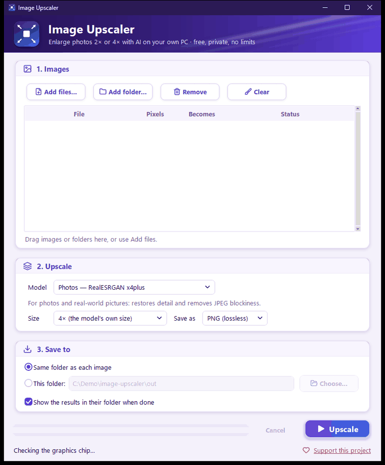

# Image Upscaler

**Free, offline alternative to paid AI image upscalers. No credits, no watermark, no uploads.**



Enlarges photos and drawings **2× or 4×** with [Real-ESRGAN](https://github.com/xinntao/Real-ESRGAN),
an AI model that adds real detail instead of just blurring the pixels bigger. Batches of any size,
with drag and drop. It runs on your own computer's graphics chip, so your images never leave it.
Works on Windows and macOS.

## Download
Get the latest version from the [Releases page](https://github.com/collinb0607/image-upscaler/releases/latest).
Nothing else to install: Real-ESRGAN and its models are built in.

| Your computer | Download | First launch |
|---|---|---|
| Windows 10/11 | `Image-Upscaler-Windows.exe` | Windows may show "Windows protected your PC" because the app isn't signed. Click **More info**, then **Run anyway**. The first start takes a few seconds. |
| Mac with Apple Silicon (M1 or newer) | `Image-Upscaler-macOS.zip` | Unzip, then open **Image Upscaler**. macOS blocks it the first time because the app isn't notarized: open **System Settings → Privacy & Security**, scroll down and click **Open Anyway**. |

On an Intel Mac, or any other system, run it from source with Python (below).

**It needs a graphics chip with Vulkan support.** That's almost every PC from the last several years
(NVIDIA, AMD, or Intel integrated graphics) and every Apple Silicon Mac. Very old PCs and virtual
machines may not have it; the app says so at startup.

## How fast is it?
Measured on a 640×427 photo made 4× bigger (2560×1708):

| Graphics | Photos model | Anime & drawings model |
|---|---|---|
| NVIDIA GeForce RTX 3060 Ti | about 4.5 s | about 2 s |
| Intel UHD Graphics 750 (integrated) | about 45 s | about 14 s |

Time grows with the image's size: a 1920×1080 image takes about 15 s on the RTX 3060 Ti.
On a PC with both, the app uses the faster graphics card automatically.

## How it works
- **Drag and drop.** Drop images or whole folders anywhere on the window (a folder adds the images
  directly inside it), or use **Add files** / **Add folder**. JPG, PNG, WebP, HEIC (iPhone), BMP and
  TIFF. The list shows each image's size now and what it will become.
- **Two models.** **Photos** (RealESRGAN x4plus) restores detail and removes JPEG blockiness in
  real-world pictures. **Anime & drawings** (RealESRGAN x4plus anime) keeps lines clean and colours
  flat in anime, cartoons and illustrations, and is 2–3× faster.
- **2× or 4×.** The models work at 4×. 2× is made from the 4× result with high-quality resampling,
  so it keeps the AI detail.
- **Transparency is kept** in PNG and WebP. JPG can't be see-through, so transparent areas become white.
- **Meant for small images.** Images that would be over 150 megapixels at 4× (about 3000×3000 to
  start with) are refused: they'd take minutes and make files of hundreds of MB.
- **Safe with your files.** Results are new files next to the original (or in a folder you pick):
  `logo.png` becomes `logo (upscaled 4x).png`. If they already exist it asks once for the whole
  batch: replace, skip those, or stop. Each file is written under a temporary name and renamed
  when finished, so Cancel never leaves half a file.
- **Private.** Results contain no camera or location data. Images are turned upright first, and
  their colour profile is kept.

## Run from source (Python)
### Setup (one time)
1. Install **Python 3.8+** from https://python.org. On Windows, tick **"Add Python to PATH"** during install.
2. Run the app (see below). The first time, it asks to install **Pillow** and **pillow-heif** (images,
   including HEIC), **certifi** (for the download) and **tkinterdnd2** (drag and drop). Click **Yes**.
3. The first time you click **Upscale**, it offers to download the official Real-ESRGAN program for
   your system (45–52 MB, from the Real-ESRGAN releases on GitHub; checked against its SHA-256). It's
   kept in `~/.image-upscaler`. Or unzip it yourself into a folder named `engine` next to
   `image_upscaler.py`.

### Run
```
python image_upscaler.py        # Windows
python3 image_upscaler.py       # macOS
```
On Windows you can also double-click `image_upscaler.py`. If you have more than one Python
installed, double-clicking can run a different one from `python` in a terminal, so it may ask to
install the components once more. The install dialog shows which Python it installs into.

## Troubleshooting
- **"No compatible graphics chip found":** update your graphics driver (from NVIDIA, AMD or Intel).
  Remote desktops and virtual machines often have no Vulkan support.
- **"The graphics chip ran out of memory":** close other programs (games, video editors), or use a
  smaller image.
- **It's slow:** integrated graphics take about 10× longer than a gaming graphics card. The
  **Anime & drawings** model is 2–3× faster than **Photos** if your image suits it.
- **Something fails with no message:** errors are also written to `image_upscaler_errors.log` in
  your temp folder. On Windows, paste `%TEMP%\image_upscaler_errors.log` into File Explorer's
  address bar. On Mac, run `open $TMPDIR/image_upscaler_errors.log`.

## Credits
Upscaling by [Real-ESRGAN](https://github.com/xinntao/Real-ESRGAN) (BSD-3-Clause) by Xintao Wang
et al., using its official [ncnn-vulkan](https://github.com/xinntao/Real-ESRGAN-ncnn-vulkan) build.

## Part of the Offline Toolkit
Also by me: [GIF Maker](https://github.com/collinb0607/gif-maker),
[Video Compressor](https://github.com/collinb0607/video-compressor),
[Audio Converter](https://github.com/collinb0607/audio-converter),
[Image Converter](https://github.com/collinb0607/image-converter) and
[Background Remover](https://github.com/collinb0607/background-remover): free, offline replacements
for websites that cap your file size, add a watermark, or want a subscription.
